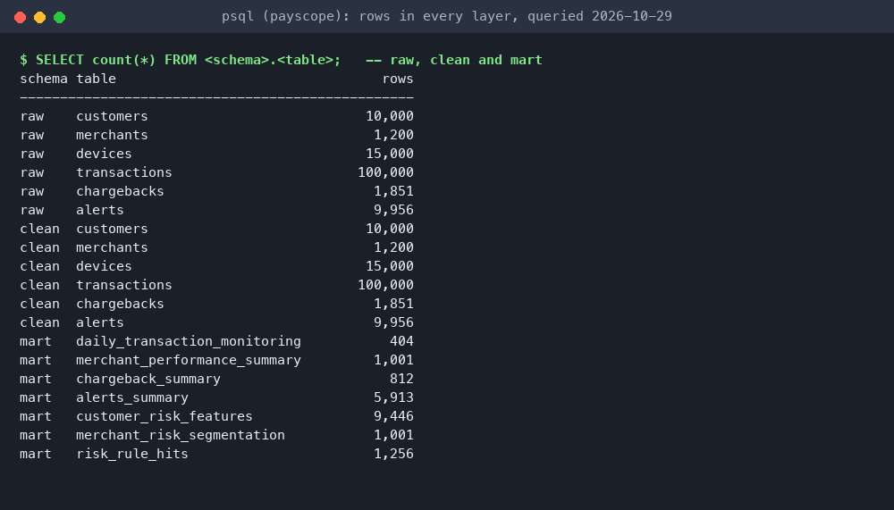
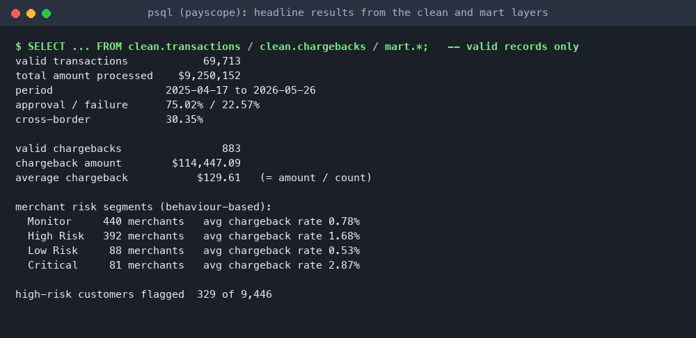
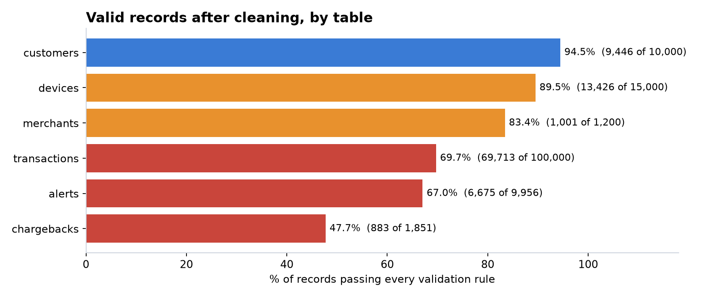
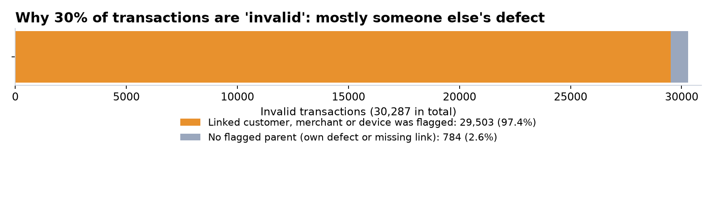
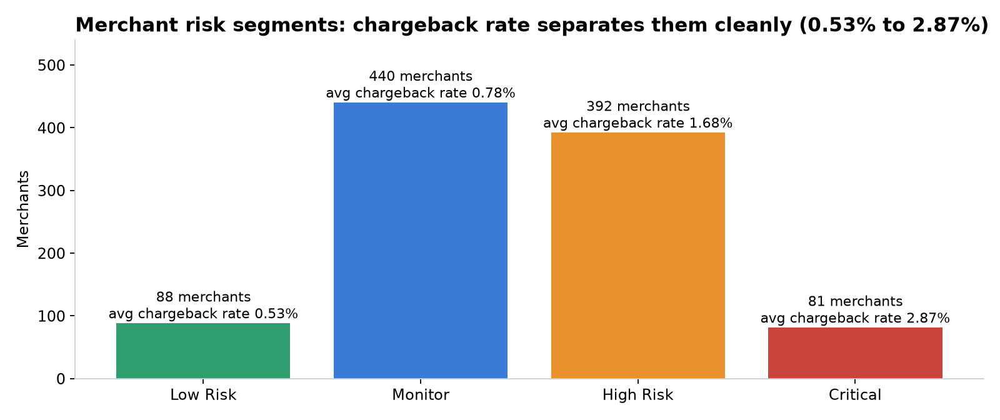
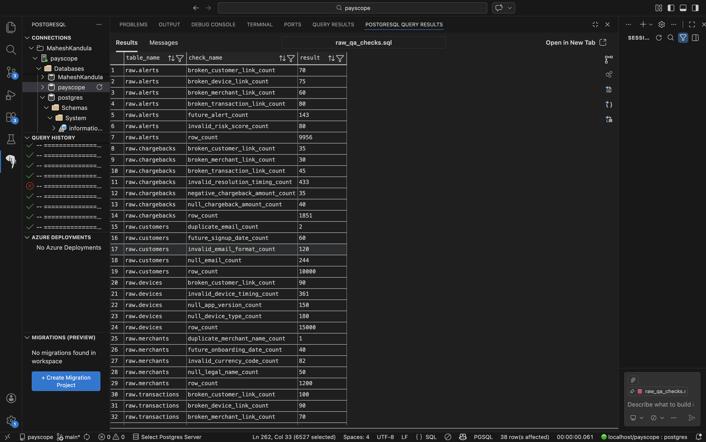
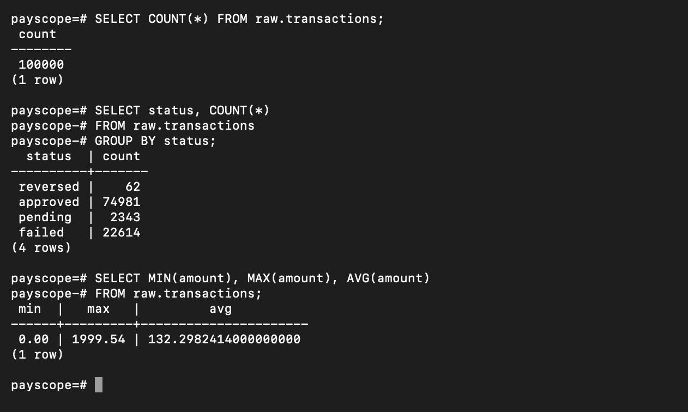
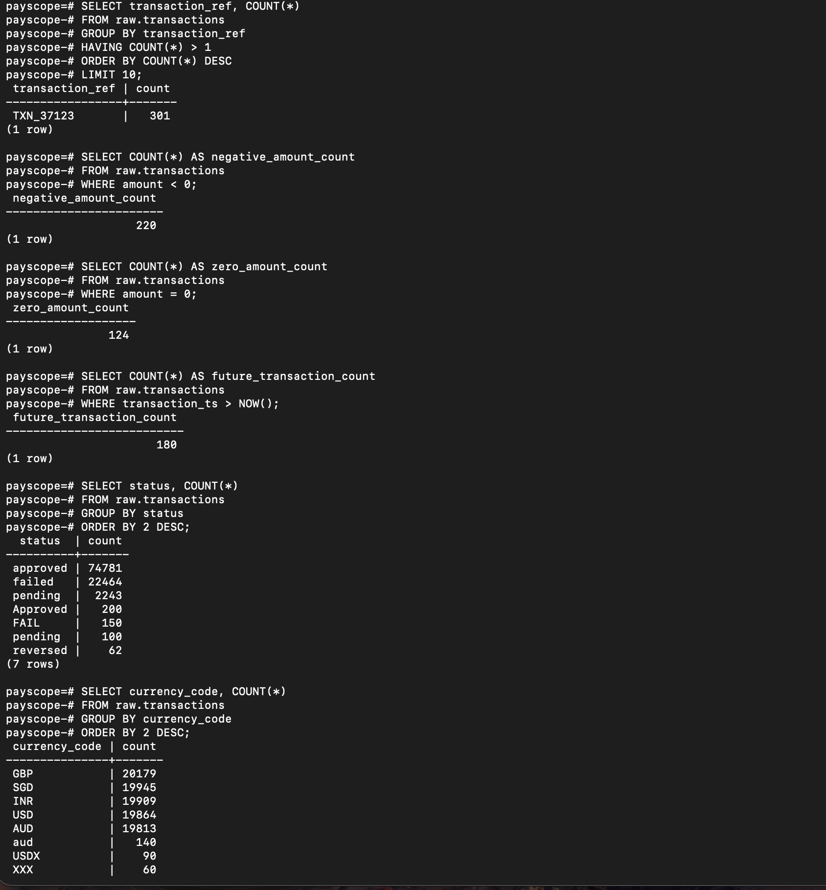
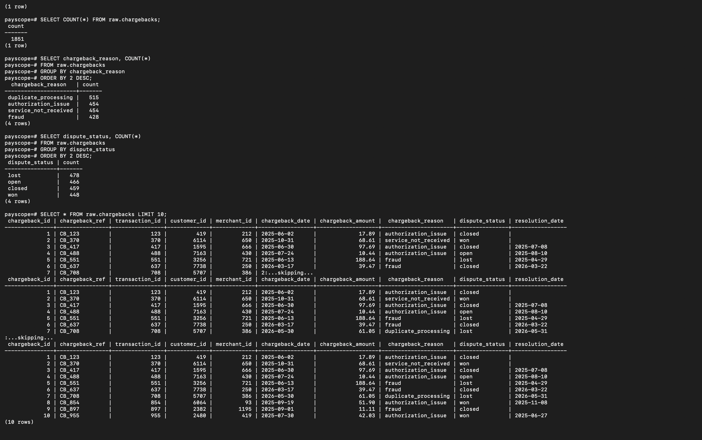
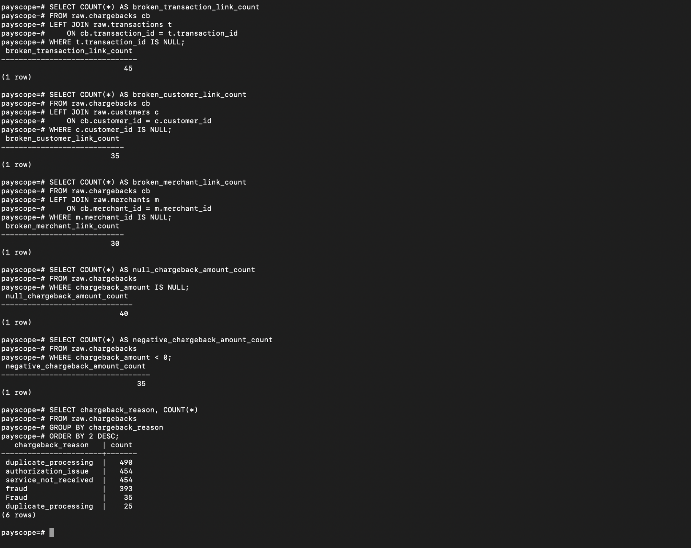

# PayScope — Digital Payments Risk & Merchant Analytics

An end-to-end digital payments analytics and risk-monitoring platform built with **PostgreSQL, Python, SQL, and Tableau**. PayScope simulates the data stack of a payments processor (think Stripe / Adyen / Square): it generates realistic operational data, deliberately injects data-quality problems, detects and cleans them through a layered pipeline, builds business marts, and surfaces transaction health, merchant risk, and chargeback behaviour through interactive Tableau dashboards.

> Built as a portfolio project to demonstrate analytics engineering, data-quality engineering, SQL, and business intelligence skills. All data is synthetically generated — no real customer data is used.

---

## Dashboards


| Dashboard | What it answers |
|---|---|
| **Transaction Monitoring** | Are payments healthy? Daily volume, approval/failure rates, cross-border activity over time. |
| **Merchant Risk** | Which merchants are risky? Failure vs chargeback scatter, segmented by behaviour-based risk tier. |
| **Chargeback Analysis** | Where do disputes come from and how do they resolve? Breakdown by reason, outcome, and weekly trend. |

---

## Why this project

Most portfolio dashboards start from a clean CSV. Real analytics work doesn't — the hard part is the messy data *before* the chart. PayScope is built to show that I can handle the full lifecycle: model a schema, generate realistic data, find and fix quality issues, build trustworthy aggregates, and only then visualise. The data-quality layer is the part most candidates skip, and it's the part this project is built around.

---

## Architecture

A layered (medallion-style) pipeline across three PostgreSQL schemas:

```
Synthetic data generation
        │
        ▼
   raw schema  ─────────►  Python extraction  ─────►  Raw QA checks
        │                                                  │
        ▼                                                  ▼
   Data cleaning & validation (Python)            (profile injected issues)
        │
        ▼
   Clean CSV outputs  ─────►  clean schema  ─────►  Clean QA checks
        │
        ▼
   Business marts (SQL)  ─────►  mart schema  ─────►  Mart QA checks
        │
        ▼
   Tableau dashboards
```

**`raw`** — source-system data, warts and all.
**`clean`** — validated data. Records are **flagged, not deleted** (`is_valid_record`, `dq_issue_count`, `cleaned_at`), preserving a full audit trail.
**`mart`** — business-ready aggregates that the BI layer reads from. Tableau never touches raw tables.

---

## Tech stack

| Layer | Tools |
|---|---|
| Database | PostgreSQL (multi-schema: `raw` / `clean` / `mart`) |
| Languages | SQL, Python |
| Python | pandas, SQLAlchemy, psycopg2 |
| BI | Tableau |
| Tooling | VS Code, Jupyter, Git/GitHub |

---

## Data model

Six core tables generated synthetically:

| Table | Rows | Description |
|---|---:|---|
| `customers` | 10,000 | Customer master data |
| `merchants` | 1,200 | Merchant master data |
| `devices` | 15,000 | Device / fingerprint metadata |
| `transactions` | 100,000 | Core payments fact table |
| `chargebacks` | 1,851 | Disputes and outcomes |
| `alerts` | 9,956 | Fraud / risk alerts |

---

## Data-quality framework

Realistic operational issues are **deliberately injected** into the raw layer, then detected and cleaned. Examples: null and duplicate emails, invalid currency/country codes, future-dated records, negative or zero amounts, broken foreign keys, impossible timestamps, and inconsistent label casing.

The cleaning pipeline flags each record rather than dropping it. Before/after results:

| Table | Total rows | Valid | Invalid | Valid rate |
|---|---:|---:|---:|---:|
| customers | 10,000 | 9,446 | 554 | 94.5% |
| merchants | 1,200 | 1,001 | 199 | 83.4% |
| devices | 15,000 | 13,426 | 1,574 | 89.5% |
| transactions | 100,000 | 69,713 | 30,287 | 69.7% |
| chargebacks | 1,851 | 883 | 968 | 47.7% |
| alerts | 9,956 | 6,675 | 3,281 | 67.0% |

Quality is profiled with SQL and Python checks at **every** layer (`raw` / `clean` / `mart`), and a before/after report quantifies the cleaning impact.

---

## Business marts

Seven marts power the BI layer:

| Mart | Purpose |
|---|---|
| `daily_transaction_monitoring` | Daily volume, approval/failure rates, cross-border rate |
| `merchant_performance_summary` | Per-merchant volume, approval, chargeback rate, alerts |
| `chargeback_summary` | Chargebacks by date, reason, and dispute outcome |
| `alerts_summary` | Alert volume by rule, severity, and status |
| `customer_risk_features` | Customer-level behavioural risk features + flag |
| `merchant_risk_segmentation` | Merchants classified into Critical / High Risk / Monitor / Low Risk |
| `risk_rule_hits` | Explainable rule-engine output (one row per triggered rule) |

---

## Risk engine

Risk is scored with **explainable rules**, not a black-box model — every flag can be explained to a business user. Rules include repeated failed payments, multiple chargebacks per customer, high-activity devices, merchant chargeback spikes, and repeated risky alerts. Merchants are then segmented (Critical / High Risk / Monitor / Low Risk) from observed behaviour — chargeback rate, failure rate, and alert volume — rather than the inherited source-system label.

> A finding worth noting: the source-system risk tier shows little relationship to actual merchant behaviour, which is exactly why a behaviour-based segmentation layer exists.

---

## Key engineering decisions

- **Raw / clean / mart separation** keeps source data, validated data, and business logic cleanly decoupled.
- **Flag, don't delete** — invalid records are marked, not removed, preserving auditability.
- **Aggregate before joining** — the merchant mart aggregates transactions, chargebacks, and alerts *separately* before joining, avoiding fact-table grain duplication and double-counting.
- **Marts feed BI, not raw tables** — Tableau reads pre-aggregated marts, keeping dashboards fast and logic centralised.
- **Explainable rules over ML** — for a risk context, transparency beats marginal accuracy.

---

## Repository structure

```
payscope/
├── sql/
│   ├── ddl/          # schema + table definitions
│   ├── seed/         # synthetic data generation
│   ├── issues/       # controlled defect injection (the "answer key")
│   ├── marts/        # business mart definitions
│   ├── qa/           # raw / clean / mart QA checks
│   └── run_marts.sql # build all marts in order
├── python/
│   ├── config/       # db connection (reads .env)
│   ├── extraction/   # raw → CSV
│   ├── dq/           # data-quality checks
│   ├── cleaning/     # validation + cleaning (6 modules)
│   ├── loading/      # clean → PostgreSQL
│   └── reporting/    # before/after summary
├── docs/             # documentation, findings, and images/ (screenshots + charts)
├── run_pipeline.sh   # rebuild the whole warehouse in dependency order
├── .env.example      # database settings template (copy to .env)
└── requirements.txt
```

Generated CSVs (`python/outputs/`) are not committed; the pipeline regenerates them. The Tableau
workbook is not stored here because it embeds a database connection; the dashboards are shown above.

---

## How to run

```bash
python -m venv .venv && source .venv/bin/activate
pip install -r requirements.txt
cp .env.example .env          # then fill in DB_USER and DB_PASSWORD (never commit .env)
createdb payscope             # a PostgreSQL database named in DB_NAME

./run_pipeline.sh             # schemas, seed, inject defects, profile, clean, load, build marts
```

Or run the stages by hand: `psql -d payscope -f sql/ddl/01_create_schemas.sql` (and the other
`ddl`, `seed` and `issues` scripts), then `python -m python.extraction.extract_raw`,
`python -m python.dq.dq_checks`, the `python.cleaning.clean_*` modules,
`python -m python.loading.load_clean`, and finally `psql -d payscope -f sql/run_marts.sql`
from the repository root. Then point Tableau at the `mart` schema.

---

## Proof of work: verified against the live database

Every figure below was queried from the running PostgreSQL warehouse (2026-10-29), not copied from
a note. The rendered terminal images are the real text output of those queries.

**What exists in each layer**



**Headline results from the validated data**



**Data quality: how much survives cleaning, and why**





Records are flagged, never deleted. Most invalid transactions are excluded because the customer,
merchant or device they point at was itself flagged, not because the payment itself is wrong.
That is the main engineering finding in the [technical report](docs/TECHNICAL_REPORT.md).

**Merchant risk segmentation from behaviour, not the source label**



**The raw layer, and the defects injected into it**

The raw QA script profiles about 4,000 injected defects (broken keys, future dates, bad codes):



| Raw data | Injected-defect checks |
|---|---|
|  |  |
|  |  |

More in [docs/images/proof/](docs/images/proof/) (customers, merchants, devices and alerts).

**Known limitations, stated up front:** the data is synthetic; the clean layer's column types are
inferred by pandas rather than enforced (a documented finding); and the validity rule is binary.
All are written up, with fixes, in the [technical report](docs/TECHNICAL_REPORT.md) and the
[upgrade roadmap](docs/UPGRADE_ROADMAP.md).

---

## Documentation

| Document | What's in it |
|---|---|
| [Project Documentation](docs/PROJECT_DOCUMENTATION.md) | Full end-to-end reference: architecture, every pipeline layer, data dictionary, business glossary, run instructions |
| [Technical Report](docs/TECHNICAL_REPORT.md) | Method, verified results, and nine findings from auditing the pipeline against its own answer key |
| [Findings](docs/findings.md) | What the pipeline produces and what can (and cannot) be concluded from synthetic data |
| [Risk Rules](docs/payscope_Riskrules.md) | The explainable thresholds behind merchant segments, the customer flag and rule hits |
| [Cleaning Logic](docs/payscope_cleaning_logic.md) | Standardise, validate and flag rules per table, with the allowed value sets |
| [Upgrade Roadmap](docs/UPGRADE_ROADMAP.md) | Prioritised improvements with code, effort estimates and rationale, plus current status |

A note on the technical report: because every data-quality defect in this project is injected deliberately, the detection layer can be graded against known truth. Doing that surfaced real defects in the pipeline: a validity cascade that excludes about 29,700 sound transactions for upstream cosmetic issues, risk thresholds sitting at the population median, and a type contract silently discarded at load. They are documented rather than quietly fixed, because finding them is the part of the work worth showing.

---

## Author

**Mahesh Sai Kandula** — Master of Data Science, Macquarie University · [LinkedIn](https://www.linkedin.com/in/mahesh-kandula-b6393622a/) · [GitHub](https://github.com/MSkandula)
